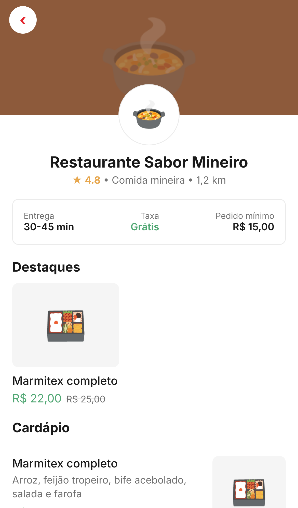
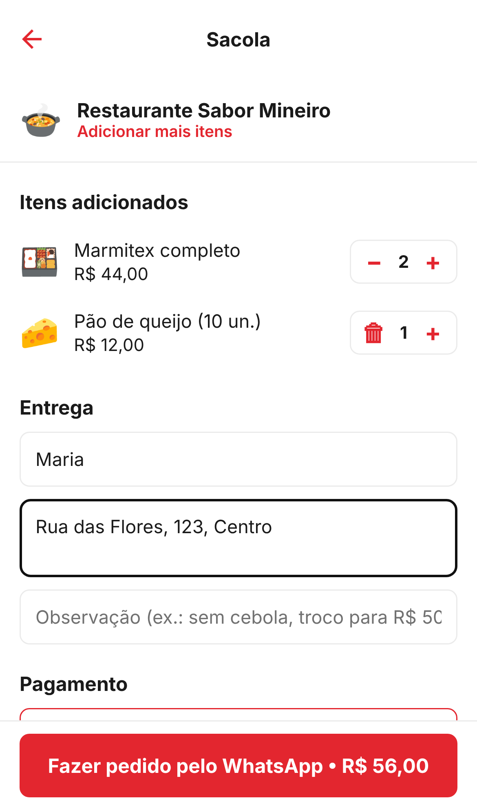
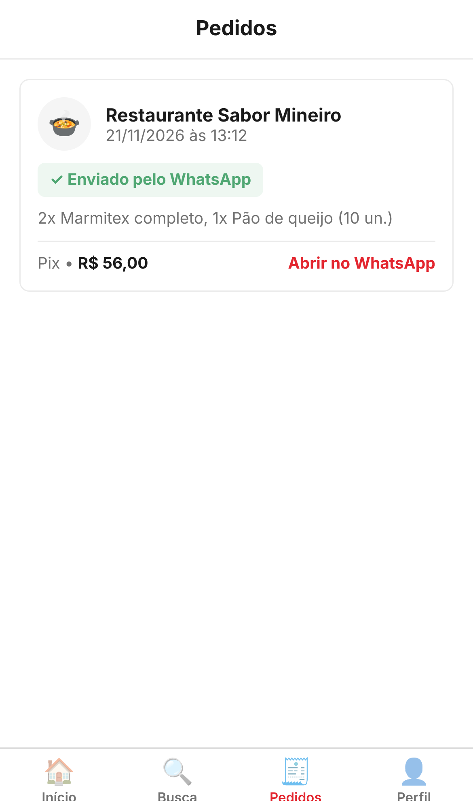
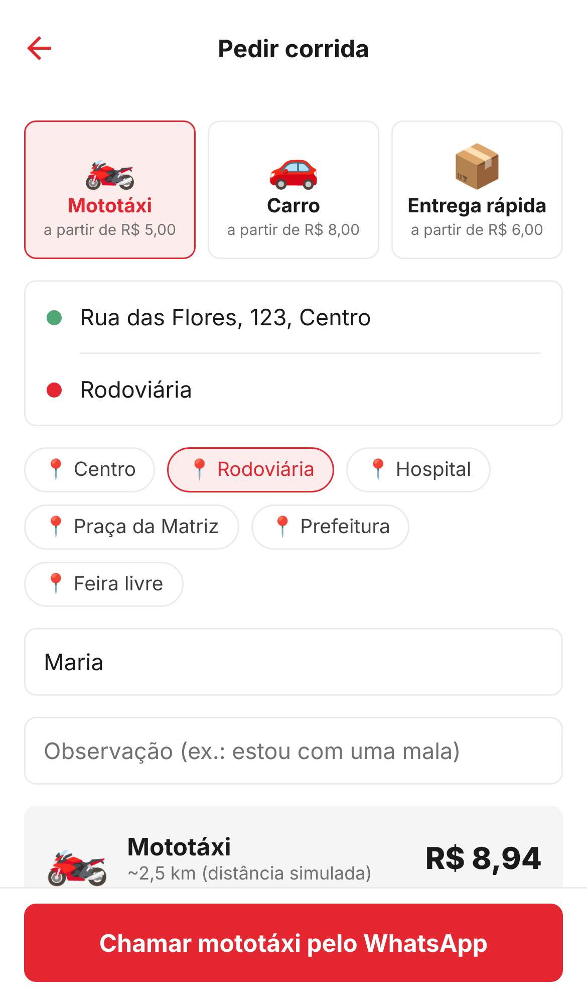
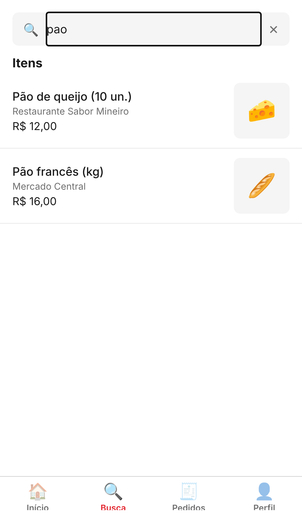

# Capelinha Delivery

Super app de delivery e transporte para **Capelinha - MG**: restaurantes, mercado, farmácia,
bebidas, pet shop, corrida de carro, mototáxi e entregas rápidas.

> **Situação atual:** protótipo do **App do Cliente** com dados de exemplo.
> Os pedidos e corridas são enviados **pelo WhatsApp** (mensagem pronta para a loja
> ou para o motoboy). As lojas cadastradas são fictícias e a distância das
> corridas é simulada.

## ⚙️ Antes de usar de verdade

1. Abra `cliente/src/config.ts` e coloque os números de WhatsApp reais
   (central e motoboy/corridas). Os que estão lá são fictícios.
2. Em `cliente/src/data/mock.ts`, troque as lojas de exemplo pelas lojas parceiras
   (nome, produtos, preços, taxa de entrega e, se a loja quiser receber direto,
   o campo `whatsapp` dela). Ali também ficam as tarifas de mototáxi, carro e entrega.

## Telas

| Início | Loja | Sacola |
|---|---|---|
|  |  |  |

| Pedidos | Corrida | Busca |
|---|---|---|
|  |  |  |

## Como testar no seu celular

Você precisa de um computador com [Node.js](https://nodejs.org) (versão LTS) instalado.

1. No celular, instale o app **Expo Go** (Play Store ou App Store).
2. No computador, baixe este repositório e rode:
   ```bash
   cd cliente
   npm install
   npx expo start
   ```
3. Vai aparecer um **QR code** no terminal. Leia com o Expo Go (Android) ou com a câmera (iPhone).
   O celular e o computador precisam estar na mesma rede Wi-Fi.

Para ver no navegador do computador: `npx expo start --web`.

## Estrutura

```
cliente/                 App do cliente (React Native + Expo)
  src/app/               Telas (cada arquivo é uma tela)
    (tabs)/index.tsx     Início: categorias, banners, famosos, lojas
    (tabs)/busca.tsx     Busca de lojas e itens
    (tabs)/pedidos.tsx   Meus pedidos (reabrir no WhatsApp)
    (tabs)/perfil.tsx    Perfil e "Trabalhe com a gente"
    categoria/[id].tsx   Lista de lojas de uma categoria
    loja/[id].tsx        Cardápio/produtos da loja
    sacola.tsx           Sacola, endereço, pagamento → WhatsApp
    corrida.tsx          Pedir carro, mototáxi ou entrega
  src/data/mock.ts       Lojas, produtos e tarifas de EXEMPLO
  src/config.ts          Números de WhatsApp (PREENCHER)
  src/context/           Estado da sacola, pedidos e dados do cliente
  src/ui/                Cores, componentes reutilizáveis
```

## Próximas etapas

1. **Protótipo do cliente** ✅ (visual estilo app de delivery + pedidos via WhatsApp)
2. **Servidor (backend):** login por telefone/SMS, banco de dados, pedidos reais
3. **App do entregador/motorista** e **painel das lojas**
4. **Mapa e GPS:** distância real, acompanhar o motoboy em tempo real
5. **Pagamento online** (Pix/cartão) e repasse para parceiros
6. **Publicação** na Play Store e App Store
