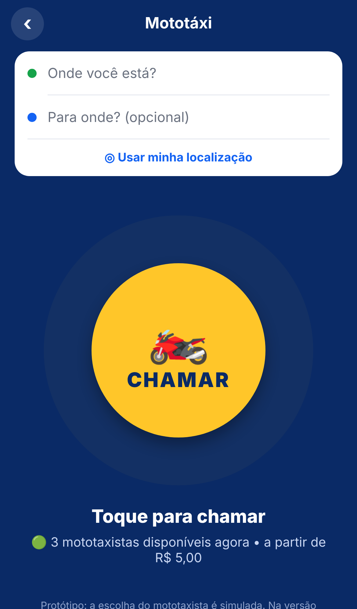
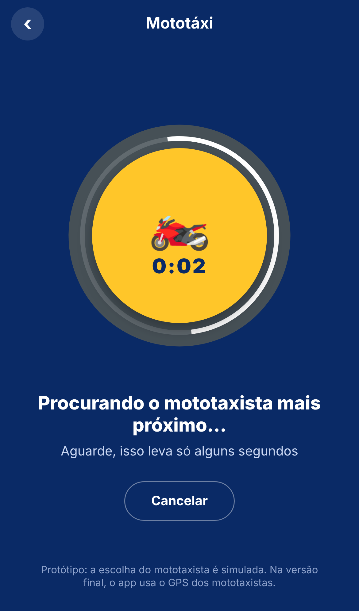
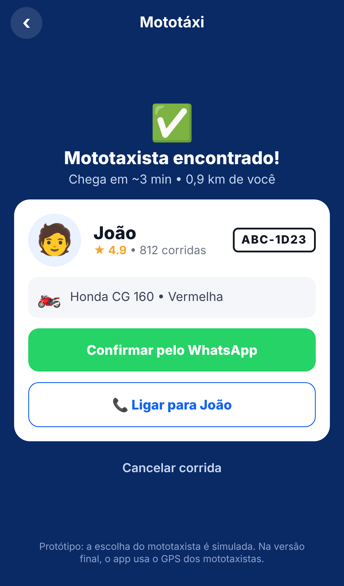
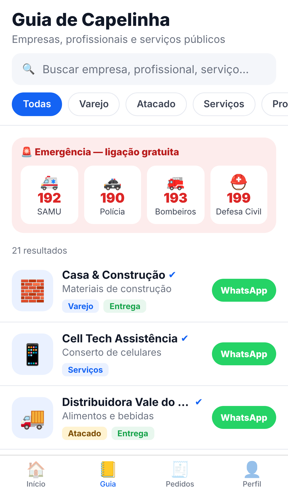
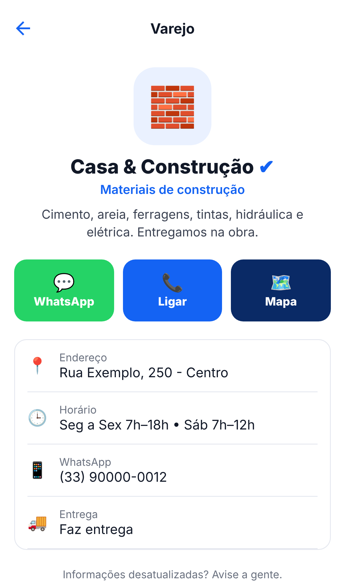
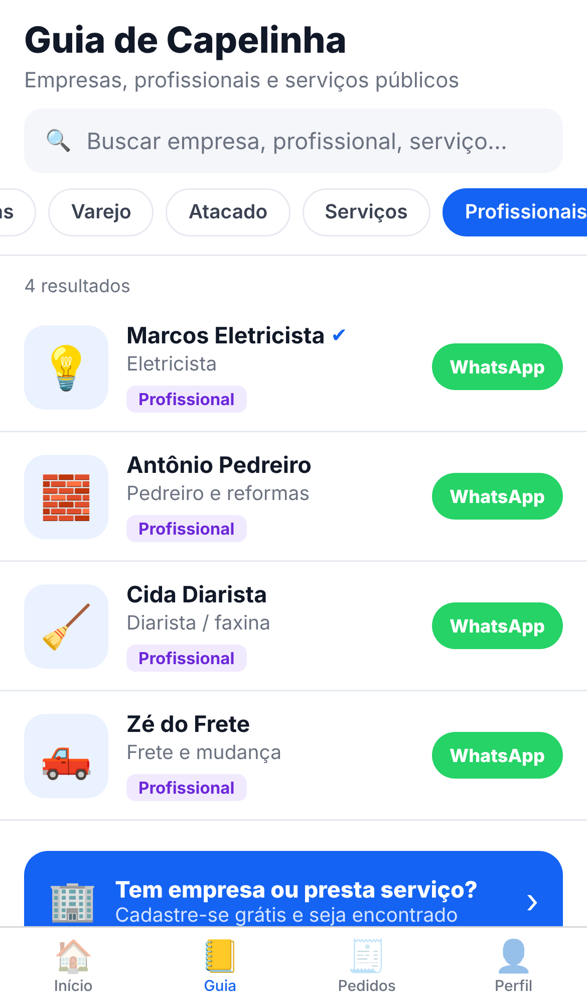
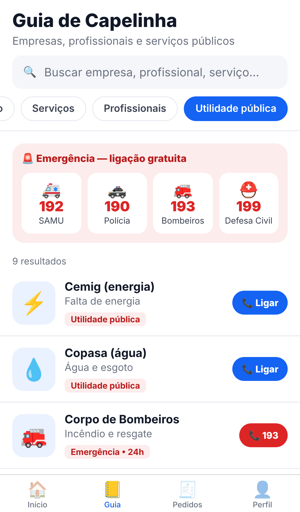
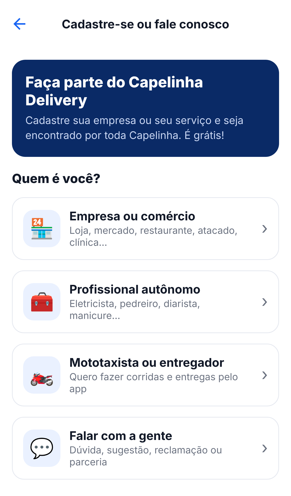
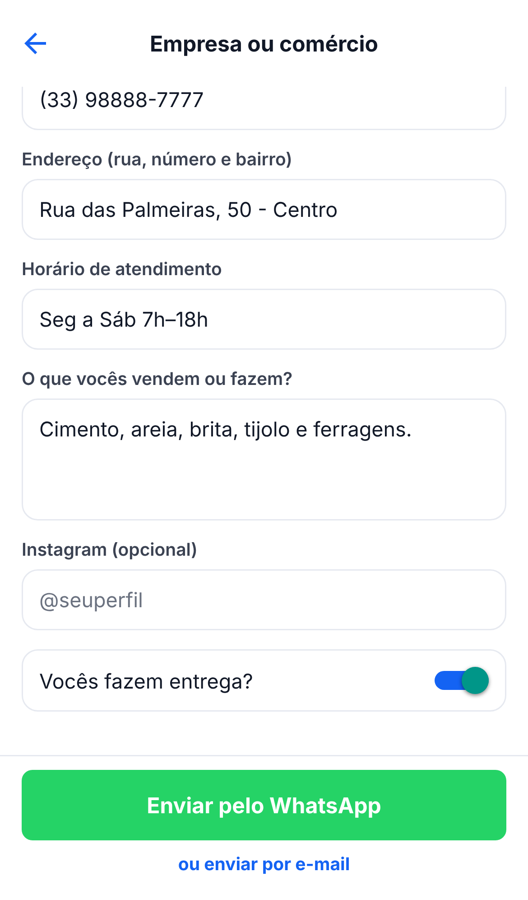

# Capelinha Conectada

**Conectar pessoas em Capelinha - MG**: cliente, mototaxista, entregador e empresas,
tudo em um só app, simples e rápido.

1. 🏍️ **Mototáxi em 1 toque**: um botão, o app pega sua localização e encontra o mototaxista mais próximo.
2. 🛍️ **Delivery**: restaurantes, mercado, farmácia, bebidas, pet shop, entregas.
3. 📒 **Guia de Capelinha**: empresas (varejo, atacado, serviços), **profissionais autônomos**
   e **utilidade pública** (emergência 190/192/193/199, Cemig, Copasa, prefeitura...),
   com contato direto (WhatsApp, ligar, ver no mapa).
4. 🚀 **Cadastre-se / Fale conosco**: empresas, autônomos e mototaxistas escolhem a
   categoria e preenchem os dados. A **ficha chega pronta no WhatsApp** (ou e-mail) do dono do app.

> **Situação atual: protótipo do App do Cliente.**
> Pedidos, corridas e contatos são enviados **pelo WhatsApp**. As lojas, empresas e
> mototaxistas cadastrados são **fictícios**, e a escolha do mototaxista "mais próximo"
> é **simulada** (a versão real precisa do app do mototaxista + servidor).

## Telas

| Início | Mototáxi | Buscando |
|---|---|---|
|  |  |  |

| Mototaxista encontrado | Guia de Capelinha | Empresa |
|---|---|---|
|  |  |  |

| Profissionais | Utilidade pública | Cadastre-se | Formulário |
|---|---|---|---|
|  |  |  |  |

## ⚙️ Antes de usar de verdade

| O quê | Arquivo |
|---|---|
| Números de WhatsApp da central, corridas e cadastros + e-mail dos cadastros | `cliente/src/config.ts` |
| Categorias do formulário de cadastro | `cliente/src/data/cadastro.ts` |
| Mototaxistas (nome, moto, placa, WhatsApp) | `cliente/src/data/mototaxi.ts` |
| Guia: empresas, profissionais e utilidade pública | `cliente/src/data/empresas.ts` |
| Lojas do delivery, produtos e tarifas de corrida | `cliente/src/data/mock.ts` |

Todos os números e o e-mail que estão lá hoje são **fictícios**, exceto os de emergência
(190, 192, 193, 199) e Cemig (116) / Copasa (115), que são os oficiais. Prefeitura, hospital
e rodoviária precisam receber os números reais de Capelinha.

## Como testar no seu celular

Você precisa de um computador com [Node.js](https://nodejs.org) (versão LTS) instalado.

1. No celular, instale o app **Expo Go** (Play Store ou App Store).
2. No computador, baixe este repositório e rode:
   ```bash
   cd cliente
   npm install
   npx expo start
   ```
3. Leia o **QR code** que aparece no terminal com o Expo Go (Android) ou com a câmera (iPhone).
   O celular e o computador precisam estar na mesma rede Wi-Fi.

Para ver no navegador do computador: `npx expo start --web`.

## Estrutura

```
cliente/                   App do cliente (React Native + Expo)
  src/app/                 Telas (cada arquivo é uma tela)
    (tabs)/index.tsx       Início: mototáxi, serviços, banners, empresas, lojas
    (tabs)/empresas.tsx    Guia de Capelinha (empresas, profissionais, utilidade pública)
    (tabs)/pedidos.tsx     Meus pedidos e corridas
    (tabs)/perfil.tsx      Perfil e "Trabalhe com a gente"
    mototaxi.tsx           Mototáxi em 1 toque (busca animada + GPS)
    empresa/[id].tsx       Página da empresa (WhatsApp, ligar, mapa)
    busca.tsx              Busca geral (lojas, produtos, empresas)
    loja/[id].tsx          Produtos da loja
    sacola.tsx             Sacola → pedido pelo WhatsApp
    corrida.tsx            Carro e entregas
    cadastro.tsx           Cadastre-se / Fale conosco → ficha no WhatsApp ou e-mail
  src/data/                Dados de EXEMPLO
  src/config.ts            Números de WhatsApp (PREENCHER)
  src/ui/                  Cores (tema azul) e componentes
```

## Próximas etapas

1. **Protótipo do cliente** ✅
2. **App do colaborador** (mototaxista/entregador): ficar "disponível", receber e aceitar corridas
3. **Servidor**: login por celular, banco de dados, mototaxista mais próximo de verdade (GPS)
4. **Painel das empresas e do administrador**: cadastrar empresas, produtos e preços
5. **Pagamento online** (Pix) e **publicação** na Play Store e App Store
